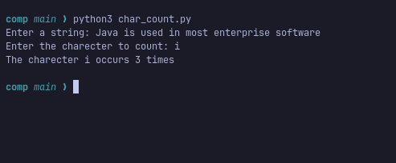
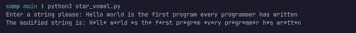
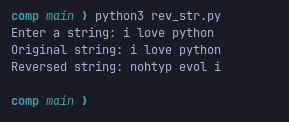
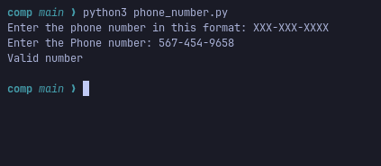
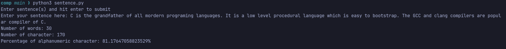
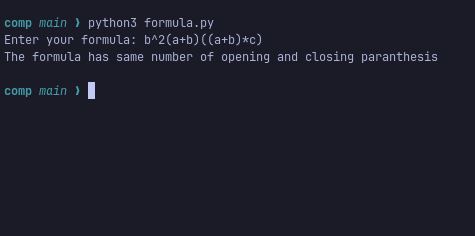
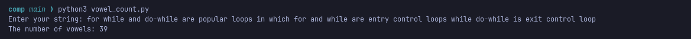
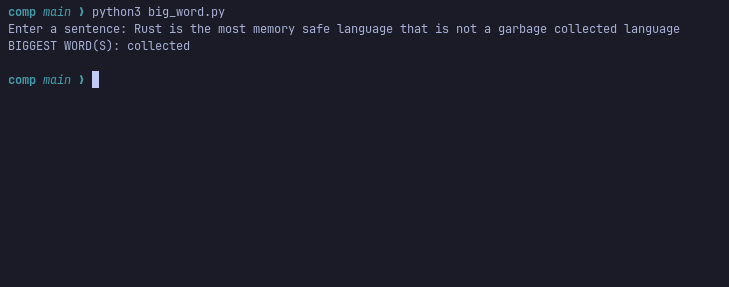
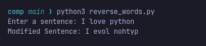

# Computer Lab - Python Exercises

This repository contains Python solutions for computer lab exercises covering string operations, validation, and parsing.

---

## Question 1: Character Occurrence Counter

**Problem Statement:**
Write a program to count the number of times a character occurs in the given string.

### Code: `char_count.py`
```python
#  1. Write a program to count the number of times a character occurs in the given string,
text= input("Enter a string: ")
while True:
    char= input("Enter the charecter to count: ")
    if len(char)==1:
        break
    else:
        print("Please enter a single charecter")

counter= text.count(char)
print("The charecter",char,"occurs",counter,"times")
```

### Terminal Output
```text
Enter a string: Java is used in most enterprise software
Enter the charecter to count: i
The charecter i occurs 3 times
```

### Output Screenshot


---

## Question 2: Replace Vowels with Asterisks

**Problem Statement:**
Write a program which replaces all vowels in the string with '*'.

### Code: `star_vowel.py`
```python
# program to print * instead of vowels
str = input("Enter a string please: ")
compare = "AEIOUaeiou"
str2=""
for i in str:
    if i in compare:
       str2+="*"
    else:
       str2=str2 + i

print(f"The modified string is: {str2}")
```

### Terminal Output
```text
Enter a string please: Hello world is the first program every programmer has written
The modified string is: H*ll* w*rld *s th* f*rst pr*gr*m *v*ry pr*gr*mm*r h*s wr*tt*n
```

### Output Screenshot


---

## Question 3: Reverse String into New String

**Problem Statement:**
Write a program which reverses a string and stores the reversed string in a new string.

### Code: `rev_str.py`
```python
# Take input from user
original_string = input("Enter a string: ")

# Initialize an empty string to store reversed characters
reversed_string = ""

# Loop through each character and prepend it to the new string
for char in original_string:
    reversed_string = char + reversed_string

# Display the results
print("Original string:", original_string)
print("Reversed string:", reversed_string)
```

### Terminal Output
```text
Enter a string: i love python
Original string: i love python
Reversed string: nohtyp evol i
```

### Output Screenshot


---

## Question 4: Phone Number Format Validator

**Problem Statement:**
Write a program that prompts for a phone number of 10 digits and two dashes, with dashes after the area code and the next three numbers. For example, 017-555-1212 is a legal input. Display if the phone number entered is valid format or not and display if the phone number is valid or not (i.e., contains just the digits and dash at specific places).

### Code: `phone_number.py`
```python
print("Enter the phone number in this format: XXX-XXX-XXXX")
number = input("Enter the Phone number: ").strip()
flag = True
reason=""
if number.count("-")!=2:
    flag=False
    reason="Wrong number of ddashes"
else:
    if len(number)!=12:
        flag = False
        reason="The number entered is not 10 digits"
    else:
        if number[3]!="-" or number[7]!="-":
            flag = False
            reason="Dashes arent in the right places"
        else:
            _number=number.split("-")
            if _number[2].isdigit()==False or _number[1].isdigit()==False or _number[0].isdigit()==False:
                flag=False
                reason="The entered number contains other charcters in the place of numbers"

if flag==True:
    print("Valid number")
else:
    print(f"Number is not valid.\nReason: {reason}")
```

### Terminal Output
```text
Enter the phone number in this format: XXX-XXX-XXXX
Enter the Phone number: 567-454-9658
Valid number
```

### Output Screenshot


---

## Question 5: Sentence Statistics

**Problem Statement:**
Write a program that should prompt the user to type some sentence(s) followed by “enter”. It should then print the original sentence(s) and the following statistics relating to the sentence(s) :
    1. Number of words
    2. Number of characters (including white-space and punctuation)
    3. Percentage of characters that are alphanumeric

### Code: `sentence.py`
```python
sentence = input("Enter sentence(s) and hit enter to submit\nEnter your sentence here: ")
number_word=len(sentence.split())
number_characters=len(sentence)
#printing the number of words and charcter
print(f"Number of words: {number_word}")
print(f"Number of character: {number_characters}")
if number_characters !=0:
    alphanumeric_counter=0
    for i in sentence:
        if i.isalnum():
            alphanumeric_counter+=1
    print(f"Percentage of alphanumeric character: {(alphanumeric_counter/number_characters)*100}%")
```

### Terminal Output
```text
Enter sentence(s) and hit enter to submit
Enter your sentence here: C is the grandfather of all mordern programing languages. It is a low level procedural language which is easy to bootstrap. The GCC and clang compilers are popular compiler of C
Number of words: 30
Number of character: 170
Percentage of alphanumeric character: 81.17647058823529%
```

### Output Screenshot


---

## Question 6: Formula Bracket Matcher

**Problem Statement:**
Write a program to input a formula with some brackets and checks, and prints out if the formula has the same number of opening and closing parentheses.

### Code: `formula.py`
```python
exprestion=input("Enter your formula: ")
left_closing_bracket = exprestion.count("(")
right_closing_bracket = exprestion.count(")")
if left_closing_bracket == right_closing_bracket:
    print("The formula has same number of opening and closing paranthesis")
else:
    print("The formula has different number of opening and closing pranthesis\nFormula is invalid")
```

### Terminal Output
```text
Enter your formula: b2(a+b) ((a+b)*c)
The formula has same number of opening and closing paranthesis
```

### Output Screenshot


---

## Question 7: Vowel Counter

**Problem Statement:**
Write a program that inputs a line of text and prints out the count of vowels in it.

### Code: `vowel_count.py`
```python
s=input("Enter your string: ").upper()
vowel="AEIOU"
vowel_counter=0
for i in s:
    if i in vowel:
        vowel_counter+=1
print(f"The number of vowels: {vowel_counter}")
```

### Terminal Output
```text
Enter your string: for while and do-while are popular loops in which for and while are entry control loops while do-while is exit control loop
The number of vowels: 39
```

### Output Screenshot


---

## Question 8: Find Biggest Word(s)

**Problem Statement:**
Write a program to input a line of text and print the biggest word (length wise) from it.

### Code: `big_word.py`
```python
sentence=input("Enter a sentence: ")
sentence = sentence.split()
big_ind = 0
big_Word=sentence[0]
for i in range(1,len(sentence)):
    if len(sentence[big_ind]) == len(sentence[i]):
        big_Word+= " & "+ sentence[i]
    elif len(sentence[big_ind]) < len(sentence[i]):
        big_Word = sentence[i]
        big_ind = i

print(f"BIGGEST WORD(S): {big_Word}")
```

### Terminal Output
```text
Enter a sentence: Rust is the most memory safe language that is not a garbage collected language
BIGGEST WORD(S): collected
```

### Output Screenshot


---

## Question 9: Reverse Each Word in Sentence

**Problem Statement:**
Write a program to input a line of text and create a new line of text where each word of input line is reversed.

### Code: `reverse_words.py`
```python
sentence = input("Enter a sentence: ")
sentence = sentence.split()
reversed_sentence = list()
for i in sentence:
    reversed_sentence += i[::-1] + " "
reversed_sentence="".join(reversed_sentence)
print(f"Modified Sentence: {reversed_sentence}")
```

### Terminal Output
```text
Enter a sentence: I love python
Modified Sentence: I evol nohtyp 
```

### Output Screenshot


